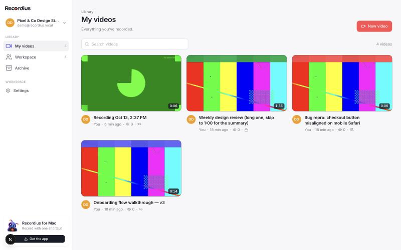
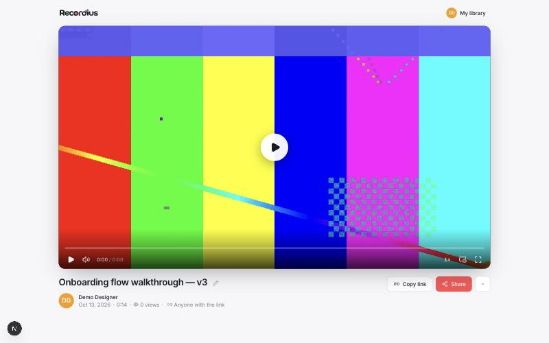
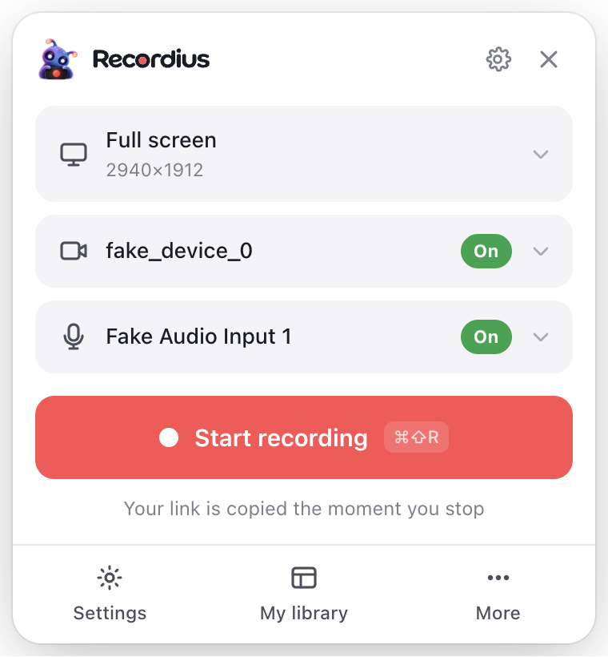
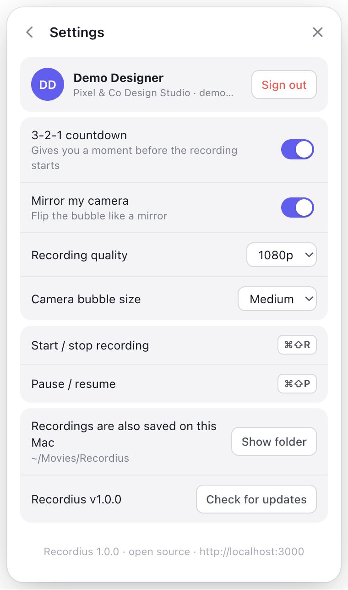

<p align="center">
  
</p>
<h1 align="center">Recordius</h1>
<p align="center">
  <b>The open-source Loom alternative you host yourself.</b><br>
  Record your screen and camera, share a link the moment you stop.<br>
  Free forever · MIT licensed · your videos never leave your servers.
</p>

<p align="center">
  <a href="LICENSE"></a>
  <a href="https://github.com/xxmorata/recordius/releases/latest"></a>
  <a href="https://github.com/xxmorata/recordius/actions/workflows/ci.yml"></a>
  <a href="SECURITY.md"></a>
</p>

<p align="center">
  <a href="#docker-any-server"><b>Docker</b></a> ·
  <a href="#vercel"><b>Vercel</b></a> ·
  <a href="#any-other-platform"><b>Railway, Render, Fly, Coolify…</b></a> ·
  <a href="INSTALL.md"><b>Step-by-step guide</b></a>
</p>

<p align="center">
  
  
</p>

## Why Recordius

|  |  |
| --- | --- |
| **Free, for real** | No paid plan, no seat limits, no video limits, no watermark, no "upgrade to unlock". The whole product is in this repository under the MIT license. |
| **Your data stays yours** | Recordings live in *your* database and *your* storage: a folder on your own server, any S3-compatible bucket (AWS S3, Cloudflare R2, Backblaze B2, MinIO…) or Vercel Blob. Recordius has no cloud of its own, no telemetry and no analytics — nothing phones home. |
| **Secure by default** | Storage is always private: nobody can open a file without a short-lived signed link that the server only issues after checking access. Passwords are hashed with scrypt, password-protected links are rate-limited, and the Mac app never sees your password. Details in [SECURITY.md](SECURITY.md). |
| **Runs anywhere** | One `docker compose up` on any Linux server or NAS, one click on Vercel, or any platform that runs a Docker image and Postgres. |

**Recordius is two things:**

- **A web app** — your team's video library, share pages with a polished player, workspaces, invites and privacy controls.
- **A Mac app** — press <kbd>⌘⇧R</kbd>, record your screen with a camera bubble, press it again: the link is already on your clipboard. The video uploads *while* you record, so there is nothing to wait for.

<p align="center">
  
  
</p>

## Get started

> **Using an AI coding agent?** Give it this link and say *"install Recordius for me"*:
> `https://github.com/xxmorata/recordius/blob/main/INSTALL.md` — every command, in order, with checks after each step.

### Docker (any server)

Needs a Linux server (or a Mac/NAS) with Docker. Database and files stay on that machine.

```bash
git clone https://github.com/xxmorata/recordius.git && cd recordius
cp .env.example .env
sed -i "s/^AUTH_SECRET=.*/AUTH_SECRET=$(openssl rand -hex 32)/" .env   # on macOS: sed -i ''
docker compose up -d                                                  # → http://localhost:3000
```

For a real domain with automatic HTTPS: point the domain's DNS at the server, set `DOMAIN=videos.example.com` and `APP_URL=https://videos.example.com` in `.env`, then run `docker compose --profile https up -d`. Details: [docs/self-hosting.md](docs/self-hosting.md#option-a--docker-compose-any-server).

### Vercel

<a href="https://vercel.com/new/clone?repository-url=https%3A%2F%2Fgithub.com%2Fxxmorata%2Frecordius%2Ftree%2Fmain%2Fweb&project-name=recordius&repository-name=recordius&env=AUTH_SECRET&envDescription=A%20long%20random%20string%20that%20signs%20sessions%20(e.g.%20openssl%20rand%20-hex%2032)&envLink=https%3A%2F%2Fgithub.com%2Fxxmorata%2Frecordius%2Fblob%2Fmain%2Fdocs%2Fself-hosting.md&stores=%5B%7B%22type%22%3A%22blob%22%2C%22access%22%3A%22private%22%7D%2C%7B%22type%22%3A%22integration%22%2C%22integrationSlug%22%3A%22neon%22%2C%22productSlug%22%3A%22neon%22%2C%22protocol%22%3A%22storage%22%7D%5D"></a>

The button creates the project in *your* Vercel account with a private Blob store and a Neon Postgres database (the free tiers are enough for a small team), and asks for one value: `AUTH_SECRET` (any long random string, e.g. `openssl rand -hex 32`). Prefer your own bucket? Skip the Blob store and set the `S3_*` variables instead.

### Any other platform

Railway, Render, Fly.io, Coolify, Dokku, CapRover, Kubernetes… anything that can build `web/Dockerfile` (or run `npm run build && npm start`) and give it a Postgres database. Store files in an S3-compatible bucket, or on a persistent disk with `STORAGE=local`. See [docs/self-hosting.md](docs/self-hosting.md#option-c--any-other-platform).

### Then

1. **Open your site** → *Set up your workspace*. The first account becomes the owner.
2. **Install the Mac app:** download `Recordius-<version>-mac.dmg` from the [latest release](https://github.com/xxmorata/recordius/releases/latest), drag it to Applications and **right-click → Open** the first time (it's signed, but not notarized by Apple).
3. **Connect it:** in the web app, *Get the app → Connect desktop app*. Your browser hands the app a sign-in token — no password typing. Allow *Screen Recording* once, then <kbd>⌘⇧R</kbd>.
4. **Invite your team:** *Settings → Members & workspace → Create invite link*.

## Features

- **Instant links** — the share URL exists before the first frame; stopping just flushes the last few seconds.
- **Screen + camera bubble, screen only, or camera only**, any display or a single window, mic, optional system audio.
- **Privacy per video**: anyone with the link · workspace members only · only you and people you invite by email. Links can have a **password** and an **expiry date** — share privately with clients who don't have an account.
- **Timestamped comments** for your team: comment at the moment you mean, click a timestamp to jump there, see comments as dots on the timeline. Only workspace members (and people you invited) see them.
- **Trim** the start and end of any video in the browser — instant, nothing is re-encoded, and you can undo it anytime.
- **Upload existing videos**: drop MP4/MOV/WebM files on the library and they get a share link like any recording.
- **Viewer insights**: see which teammates watched and how far they got; anonymous viewers are counted too.
- **Rich link previews**: pasting a public link into Notion, Slack, Confluence and other oEmbed apps shows a playable video.
- **Uploads that never get lost**: if the network drops, the Mac app keeps the recording and finishes the upload by itself later — even after a restart.
- **Library**: search, sort, filter by person, select several videos to archive, delete or change access at once. The Mac app lists your latest videos with a one-click *Copy link*.
- **Name it right away**: after you stop, the share page opens with the title ready to type — or click any title to rename it in place.
- **Player**: speed control, keyboard shortcuts (press <kbd>?</kbd>), picture-in-picture, fullscreen, link-at-timestamp (`?t=1m23s`), embed code.
- **Custom thumbnails**: pick any frame of the video as its preview image.
- **Workspaces & invites** — roles: owner, admin, member. Admins reset passwords with one-time links; no email server needed.
- **Updates that keep permissions** — the Mac app updates itself and macOS never asks for Screen Recording access twice.

## Documentation

- [Install guide](INSTALL.md) — step by step, for people and AI agents.
- [Self-hosting](docs/self-hosting.md) — Docker, Vercel and other platforms, storage options, environment variables, updates, backups.
- [Security](SECURITY.md) — how your data is protected and how to report a vulnerability.
- [Mac app](docs/desktop.md) — install, connect, permissions, shortcuts, troubleshooting, building from source.
- [Architecture](docs/architecture.md) — how recording, uploading and access control work.
- [Contributing](CONTRIBUTING.md) — local setup, tests, project layout, releases.

## FAQ

**Is it really free?** Yes. There is no hosted Recordius service and no paid edition — you run it, you own it. Your only costs are your own server or the free tiers of the services you pick.

**Where are my videos stored?** Wherever you configure: a folder on your server (the default with Docker), your own S3-compatible bucket, or your Vercel Blob store. Metadata is in your Postgres database. Nothing is sent to us — we never see your videos.

**What does the Mac app connect to?** Only your own Recordius server, plus GitHub to check for app updates.

**Windows or Linux recorder?** Not yet — the recorder is a Mac app today. Anyone can watch, comment and upload videos from any browser.

**Can I move to another host later?** Yes: back up Postgres (`pg_dump`) and copy your files; the schema is the same everywhere.

## License

[MIT](LICENSE). Recordius is an independent project and is not affiliated with Loom or Atlassian.
